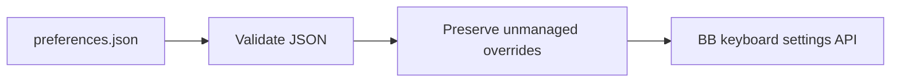

# Declarative keyboard preferences

This headless plugin applies `~/.config/bb/preferences.json` through BB's public SDK.
The file lives on the BB server machine. It contains the desired previous and next
thread shortcuts, scoped by platform. Other overrides stay unchanged.

The background service reads the file on startup and watches its parent directory.
Valid file changes apply automatically. Invalid files leave existing bindings intact
and produce a plugin log entry. The watcher stops on disable, reload or shutdown.

Run `bb preferences apply` to reapply the file explicitly.
Inspect errors with `bb plugin logs preferences`.
Disable with `bb plugin disable preferences` to stop watching.
Disabling keeps the applied shortcuts.

## Limits

- Only `thread.previous` and `thread.next` are supported.
- The file path is fixed to `~/.config/bb/preferences.json`.
- Removing an entry leaves its last applied override under UI control.
- UI edits remain until the file changes, the plugin restarts, or explicit apply runs.
- Conflict display, settings-file precedence and remote host file access are outside this plugin.
- The SDK pin is the workspace's existing 0.6.15. BB reports 0.6.37; the used API
  passes typecheck, build and live verification on the installed BB.

## Verification

Run `pnpm test`, `pnpm typecheck` and `pnpm build` in this directory.
Live verification changes a shortcut in the file, observes the API, submits invalid
JSON, and restores the desired shortcuts. No database files enter source control.
