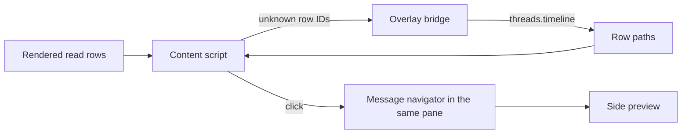

# Read Links

File names in timeline read rows open the file in BB's side preview. This covers
"Read file", "Viewed image" and shell commands BB labels as reads, such as `cat` or `head`.

## Behaviour

- Hover a file name to see its full path. Click it, or focus it and press Enter, to open the preview.
- The rest of the row keeps BB's behaviour, including expand and collapse.
- Modifier clicks keep BB's handling. A declined preview falls through to BB.
- A command that reads several files links each title to its own file.
- Rows streamed after the page loads are linked once their timeline data arrives.
- In split panes, the file opens in the preview of the pane that holds the row.

## Scope

- Absolute paths link. `~/` paths expand against the thread host's home directory.
- Relative shell reads link only when the row records a working directory.
  Claude Code records none for shell commands, so `cd dir && cat file` stays plain text.
- A row is left alone when BB renders a different number of titles than the timeline reports.
- Threads without an environment have no host and stay plain text.
- Remote hosts are untested.

## How it works

`threads.timeline` supplies paths and working directories, keyed by the rendered
`data-timeline-row-id`. The content script decorates the title's truncating file
segment. BB only lets thread surfaces open previews, so a hidden
`experimental_messageMetadata` component lends its pane's `useBbNavigate()`.
The overlay's navigator declines. [SDK frictions](../docs/sdk-frictions.md#timeline-read-rows-cannot-open-the-file-they-read)
records the missing core action.

Selectors and row-ID formats are version-dependent. The decoration fails closed:
unknown markup stays plain text.

## Development

Use the workspace's [build, installation and reload procedure](../README.md).
Run `pnpm test`, `pnpm typecheck` and `pnpm build` in this directory.
