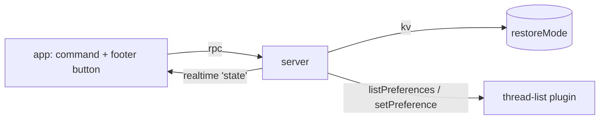

# Recent Threads

Toggles BB's built-in sidebar thread list between global recent threads (`chronological`) and your previous grouping (`project` or `machine`).

## Use

| Action | How |
| --- | --- |
| Toggle view | `Alt+R`, the sidebar footer clock button, or the palette: "Toggle recent threads view" |

Rebind `Alt+R` in **Settings -> Keyboard**.

The footer button highlights while `chronological` mode is active. Switching back restores whichever non-chronological mode (`project` or `machine`) was active before.

## Design

- The built-in `thread-list` plugin owns `organizationMode`. Every toggle reads the live preference first so manual changes made through the **Organize** menu stay in sync.
- `restoreMode` lives in plugin storage so reloading preserves whether to return to `project` or `machine`.
- `thread-list` preferences sync across open BB windows, so toggling updates every window.

## Verification

Run `pnpm test`, `pnpm typecheck`, and `pnpm build` in this directory. After installing or reloading, run the toggle and verify `bb thread-list prefs get organizationMode` flips between `"project"` and `"chronological"`.
