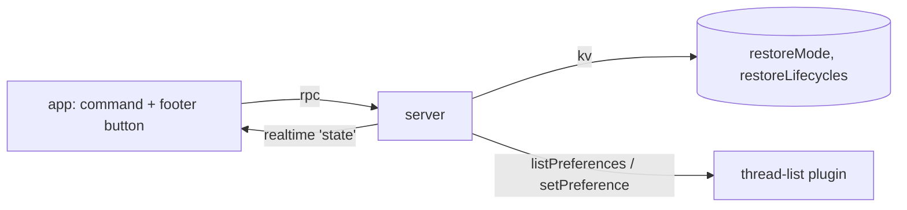

# Recent Threads

Toggles BB's built-in sidebar thread list between global recent threads (`chronological`) and your previous grouping (`project` or `machine`), and between archived-only and your previous lifecycle filter.

## Use

| Action | How |
| --- | --- |
| Toggle recent view | `Alt+R`, the sidebar footer clock button, or the palette: "Toggle recent threads view" |
| Toggle archived view | The sidebar footer archive button, or the palette: "Toggle archived threads view" |

Rebind `Alt+R`, or bind the archived toggle, in **Settings -> Keyboard**.

Each footer button highlights while its view is active, and the two combine: clock plus archive lists recently archived threads first, because archiving bumps a thread's update time. The archive button keeps the current grouping, so it also works project by project.

Switching recent back restores whichever non-chronological mode (`project` or `machine`) was active before. Switching archived back restores whichever filter was active before (Active, or Active + Archived).

## Design

- The built-in `thread-list` plugin owns `organizationMode` and `threadLifecycles`. Every toggle reads the live preferences first so manual changes made through the **Organize** and **Filter** menus stay in sync.
- `restoreMode` and `restoreLifecycles` live in plugin storage so reloading preserves what each toggle returns to.
- `thread-list` preferences sync across open BB windows, so toggling updates every window.

## Verification

Run `pnpm test`, `pnpm typecheck`, and `pnpm build` in this directory. After installing or reloading, run the toggle and verify `bb thread-list prefs get organizationMode` flips between `"project"` and `"chronological"`, and `bb thread-list prefs get threadLifecycles` flips between `["active"]` and `["archived"]`.
