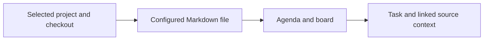

# Repo Tasks

A read-only agenda and board for tasks stored in a BB project's Markdown.

Open **Repo Tasks** from BB's navigation. Choose a project and checkout.
The task source defaults to `TODO.md`. **Source** changes its relative path for
that project. Configuration stays in BB; task files stay unchanged.

## Task format

- Unchecked Markdown checkboxes appear as tasks, including before a section heading.
- Plain list items under sections appear as tasks. Introductory items under `TODO` or `Tasks` stay prose.
- Completed checkboxes, Done/Completed/Archive sections and fenced examples stay hidden.
- Waiting, Doing/In progress and Triage/Inbox headings define board states. Other headings map to Next.
- `blocked on` and `After <event>` tasks appear in Waiting.
- Leading dates define deadlines. `Before` and `By` preserve their qualifier.
- `After YYYY-MM-DD` defines availability. `w/c` dates appear under Dates to clarify.
- A `Before YYYY-MM-DD` section supplies its date to undated items beneath it.
- Other dates inside descriptions remain text. The parser does not infer invoice dates or completion from prose.
- A short `Client:` prefix supplies the client filter. Engagement links supply it when no prefix exists.
- Local Markdown links provide expandable context. BB file links open their source documents.

The agenda calculates its date groups using the viewer's local date.
Past dates need review; they do not prove that work remains undone.

## Refresh and limits

The selected source refreshes every 15 seconds while the page is visible,
when the page becomes visible, and with the refresh button. The last successful
read stays visible after a refresh failure, with a stale-data warning.

The plugin reads the selected project checkout through BB's host-aware file API.
It does not scan journals, other projects or other task files. It does not write
tasks, send communications or start agents. **Source** changes only plugin configuration.
Task sources are limited to 256 KiB; inline context is limited to 512 KiB.
Paths remain within the selected project and exclude hidden folders.

## Development

From the parent pnpm workspace, run `pnpm install`. Inside this directory:

1. Run `pnpm test` and `pnpm typecheck`.
2. Run `pnpm build`.
3. Install with `bb plugin install path:~/src/bb-plugins/repo-tasks`.
4. After changes, build and run `bb plugin reload repo-tasks`.

The SDK pin matches the other local plugins. New scaffold SDK versions can
remain inside the package quarantine; this plugin uses the existing reviewed pin.
