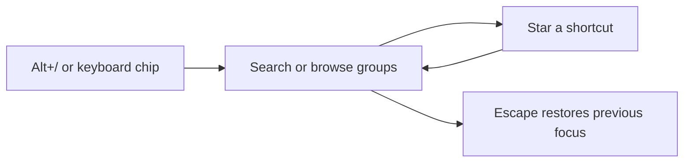

# Shortcut Guide

Press `Alt+/` or click the keyboard chip in a thread header to open the guide.
The shortcut also works on the New thread screen. Rebind **Show shortcut guide**
in Settings → Keyboard.

The guide uses the shared popover from [Chip](../chip/README.md), as Git Glance does.
It follows BB's theme and respects reduced motion.

## Use

1. Open the guide with `Alt+/`. Search has focus.
2. Browse **Essentials**, star personal **Favourites**, or choose **Browse** for
   the wider curated selection. Search covers all three views.
3. Press **Escape** to close and return to the previous control or draft.
   Read the displayed chord, close the guide, then press that chord to use it.

| Key | Action |
| --- | --- |
| Up / Down in search | Select a command |
| Cmd+S / Ctrl+S in search | Star or unstar the selected command |
| Enter in search | Close and return to practise the selected chord |
| Escape | Close, including when search contains text |
| Tab | Move through collection buttons, commands and stars |

Clicking a command closes the reference. It does not run the command.
Favourites persist in this client's browser storage and update across its windows.
If storage is unavailable, they last for the open guide and a notice explains it.

## Bindings and selection

Essentials is a hand-picked selection. It includes thread navigation, the
composer, models, files, terminal, Git Glance, agent usage and the command palette.
Browse adds pane movement, panel tabs, account switching and other local tools.
The guide deliberately omits the rest of BB's command catalogue.

Each open reads native defaults, keyboard overrides and enabled plugins through
BB's public SDK. Platform-specific overrides beat global overrides. Disabled
bindings show **Unassigned**. Platform and desktop-only bindings follow the client
that opens the guide.

Local plugin names and default chords live in `catalogue.ts`. Their overrides
are read live, and disabled plugins disappear. Native chord conflicts leave a
plugin default unassigned, as BB does. The SDK does not expose the frontend
command registry. Unlisted plugins and their potential conflicts are outside
this reference. Check its entries when changing a listed plugin's defaults.

## Usage tracking

The guide records no key presses, command executions, clicks or draft text.
Favourites are its only saved data. Essentials has no usage-based ranking.

BB's palette keeps eight recent action IDs on the client. It does not count
shortcut use or distinguish keyboard, palette and pointer actions. The Plugin
SDK has no command-execution observer. A Key Promoter feature needs that host
contract before it can report reliable usage or teach click alternatives.

## Verification

Run `pnpm test`, `pnpm typecheck` and `pnpm build` in this directory.
Tests cover platform bindings, overrides, disabled plugins, native conflicts,
search, favourites, error display, Escape isolation and draft focus restoration.
Use a live browser to check native dialog behaviour and keyboard-layout handling.
