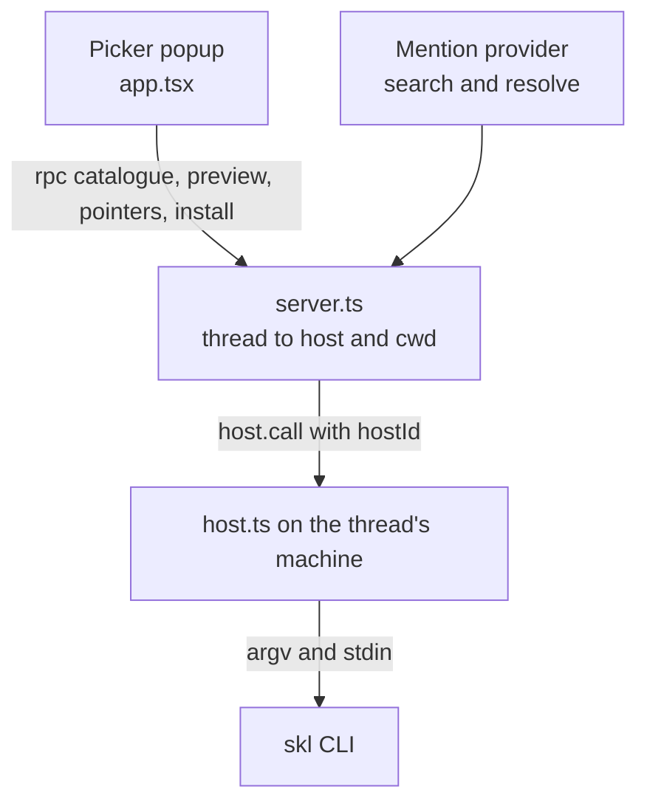

# Skill Loader

Load skills from the `skl` catalogue into the composer. A chosen skill becomes
an `@` pill. At send time the pill resolves to the pointer that `skl load`
pastes in tmux, and skl records the load in its usage history. The agent gets the pointer as hidden context, and the message
shows `mine/tdd` instead of a pasted block.

skl is the source of truth. The plugin runs `skl` on the thread's machine for
every list, preview, pointer and install. It never reads the catalogue itself.
bb's own skills (`~/.bb/skills`, plugin skills) are a separate set, and bb
cannot see the skl catalogue.

Q closes the focused pop-up outside text fields. Esc also dismisses it.

## Use

- `Alt+S` in a composer, or **Load skill…** in the composer + menu, opens the
  picker over `skl list --folders`.
- Type `@` and part of a skill name to pick from the **Skills (skl)** mention
  menu. A bare `@` lists no skills, because file mentions share it.

Use row checkboxes to mark skills. The footer offers Load, Copy, Install,
Preview and Close. Group installation has explicit Install group and Cancel
buttons. Compact previews stack below the list.

Picker keys follow the tmux `skl-pick` fzf binds:

| Key | Effect |
| --- | --- |
| `tab` / `shift-tab` | Mark the row and move down / up. |
| `↑` `↓`, `ctrl-n` `ctrl-p`, `ctrl-j` `ctrl-k` | Move. |
| `enter` | Insert one pill per marked row, or for the cursor row, then close. A folder row gives one group pill. |
| `ctrl-y` | Copy the joined pointers, as `skl load --copy` does. skl records them as BB loads. |
| `alt-i` | Install into the thread's checkout with `skl install --stdin`. A folder row asks `y / N` first. |
| `ctrl-/` | Toggle the preview pane (`skl preview`). |
| `esc` | Close. |

Rebind `Alt+S` in Settings → Keyboard. bb and the other plugins here bind no
`Alt+S` by default.

## Design

- **Pills, not pasted text.** A pill resolves once per send with one
  `skl load --stdin --print`. skl prints the joined pointers and appends one
  `mode: "bb"` record per skill to `~/.local/state/skl/history.jsonl`. A group
  pill expands at send time, so it always matches the current group. The
  picker's preview pane uses `skl preview`, which records nothing. The agent
  receives an agent-only input that starts `Context for @<label>`.
- **The pill id carries the host.** bb calls `resolve(itemId)` with no thread
  context, so ids are `<hostId>|<ref>`.
- **Ref-scoped, ranked filter.** Every term must match the ref, not the
  description, as a subsequence, like `fzf --nth=1`. Rows rank as fzf does:
  exact name, name prefix, ref substring at a boundary, substring, then the
  tightest subsequence. Equal scores keep list order, so an exact name never
  falls out of the 30-row mention menu.
- **Refs are one token with no leading `-`**, so a ref never reaches skl's argv
  as a flag.
- **The catalogue is cached per host** for the 2 s mention search budget.
  bb never sends a bare `@` to providers, so a `warm-catalogue` service loads
  the primary host once per plugin load. An entry older than 60 s answers at
  once and reloads in the background. The picker always reads it fresh.
- **The server picks the install cwd from the thread.** The app never sends a
  path. A composer with no thread yet uses the primary host and cannot install.
- **skl runs without git's repository variables.** `skl install` finds its
  project with `git rev-parse`. The runner strips every variable from
  `git rev-parse --local-env-vars`, so a variable a hook exported cannot
  redirect it to another repository.
- skl runs with `~/.local/bin` first on `PATH`, as the tmux popup does.

| File | Role |
| --- | --- |
| `src/rows.ts` | Parse `skl list --folders`, filter and rank, find group refs. |
| `src/picker.ts` | Keyboard reducer. Letters match on `KeyboardEvent.code`, because macOS Alt+I gives `ˆ`. |
| `src/mention.ts` | Pill id encode and decode, pill parts, mention menu rows. |
| `src/skl.ts` | skl CLI adapter over a `Run` port. One unknown ref fails the batch. |
| `src/run.ts` | `spawn` runner: stdin, cwd, timeout, clean env, ENOENT as 127. |
| `src/target.ts`, `src/cache.ts` | Thread to host and cwd. Stale-while-revalidate cache with single flight. |

## Limits

- **A pill keeps its host.** A pill copied to a thread on another machine still
  resolves against the first host. A pill made in a new-thread composer names
  the primary host, even if the thread then starts elsewhere.
- **Search is cut at 2 s.** The first search on a host other than the primary
  host can miss, because its catalogue is not warm yet.
- **No skl rows in home-checkout threads.** bb's own path search scans the
  checkout. In a thread on `~` it fails on `~/.Trash` (EPERM). bb then shows
  "Failed to load suggestions" for the whole `@` menu and hides the plugin
  rows. `Alt+S` still works there.
- **Resolve has 10 s per pill; the plugin uses 9 s.** A failure blocks the
  send. bb resolves pills one after another, and each pill runs one
  `skl load --stdin --print`. A slower host or a bigger group can hit the
  limit.
- **The pointer is hidden from the user** and cannot be edited per message.
- **No pane target.** Pills reach bb composers only. `ctrl-y` covers the rest.
- **No toasts.** Copy closes silently. Errors and install output show inline.
- **Clipboard.** `ctrl-y` writes through `experimental_copyToClipboard`. It
  closes the popup only when the write succeeds.
- **Tests cover the pure core, host entry and visible picker actions.**

Seen in a running bb (web UI, bb 0.46): `Alt+S` and the + menu open the
popup with focus in the filter, pills and group pills with the Layers icon,
`@` mention rows, preview, `ctrl-y` copy and the folder install prompt, in
light and dark themes. Not yet seen: pill resolve at send, a resolve error
blocking the send, and whether `preventDefault()` stops macOS composing `ˆ` on
Alt+I in the desktop app. These are checked only against bb's source in
`~/git/getbb`.

## Checks

Run from this directory:

- `pnpm test` runs the `node:test` suites and the Vitest picker test. Two tests use the real `skl` and
  skip when it is missing.
- `pnpm typecheck`
- `pnpm build`
- With BB open in a disposable Playwright session, `playwright-cli -s=<session> run-code --filename=touch.test.js` checks checkbox corner taps at four touch widths and desktop. It marks and unmarks skills without loading or installing.

Install with `bb plugin install path:~/src/bb-plugins/skill-loader`.
