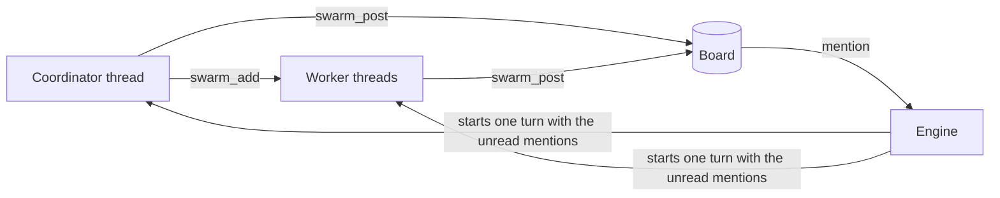

# Swarm

Agent threads from any BB provider coordinate through one shared board.

A thread becomes a coordinator when its agent calls `swarm_add`. Each worker is a child thread with its own brief. Members post to an append-only board, and a mention such as `@scout` is the only thing that wakes a member. An idle member costs nothing.



## Use

Ask an agent for a swarm. It follows the bundled [swarm-board skill](skills/swarm-board/SKILL.md).

| Agent tool | Who | Effect |
| --- | --- | --- |
| `swarm_add` | Coordinator | Starts a worker on a brief. The first call opens the swarm. |
| `swarm_post` | Any member | Appends a post. Mentions wake their targets. |
| `swarm_read` | Any member | Shows the board and each member's state. |
| `swarm_close` | Coordinator | Ends the swarm, then stops and archives every worker. |

From a shell, `bb swarm list`, `read`, `post` and `close` do the same for you. A post from outside the swarm is authored by `human`, and goes to the coordinator when it mentions nobody.

Workers appear under the coordinator in the sidebar and share its workspace. The settings cap live members (6) and wakes (100) per swarm.

## Rules the engine applies

1. **Wake.** An idle member with unread mentions gets all of them in one message. Mentions that arrive during a turn wait for it to end.
2. **Relay.** A worker turn that ends without a post is posted to the coordinator as that worker's reply.
3. **Stall.** When every member is idle and nothing is unread, the coordinator gets one notice.
4. **Close.** Closing stops every live worker. Archiving the coordinator thread closes the swarm.
5. **Limits.** At the wake limit the swarm pauses and records it on the board.

A wake lost while the plugin is unloaded is not re-sent. The stall notice covers it.

## Develop

```sh
pnpm test        # engine, board and service
pnpm typecheck
pnpm build
```

| File | Role |
| --- | --- |
| [src/engine.ts](src/engine.ts) | `decide(swarm, input)`: the whole policy, with no I/O |
| [src/domain.ts](src/domain.ts) | Board entries, members and mention parsing |
| [src/board.ts](src/board.ts) | SQLite storage port |
| [src/service.ts](src/service.ts) | Use cases behind the tools and the CLI |
| [server.ts](server.ts) | Binds the service to BB threads, events, tools and the CLI |

Tests use `node:sqlite` because the workspace blocks the install script that builds `better-sqlite3`.
