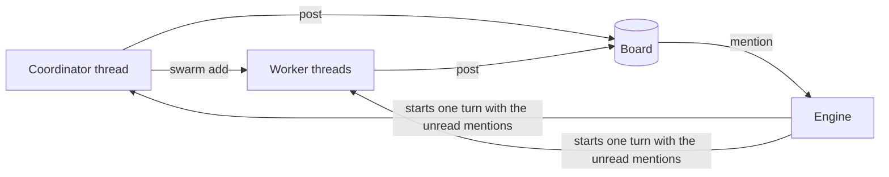

# Swarm

Agent threads from any BB provider coordinate through one shared board.

A thread becomes a coordinator when its agent calls the `swarm` tool with action `add`. Each worker is a child thread with its own brief. Members post to an append-only board, and a mention such as `@scout` is the only thing that wakes a member. An idle member costs nothing.



## Use

Ask an agent for a swarm. It follows the bundled [swarm-board skill](skills/swarm-board/SKILL.md).

| Agent tool | Offered to | Effect |
| --- | --- | --- |
| `swarm` with `add` | Every thread that is not a worker | Starts a worker on a brief. The first call opens the swarm. |
| `swarm` with `post`, `read`, `close` | The same threads | Posts, shows the board, or ends the swarm and archives every worker. |
| `swarm_post`, `swarm_read` | Workers | Posts to the board, or shows it. |

Ordinary threads carry one tool, so a thread that never runs a swarm pays for one description.

A swarm shows in three places, all live:

- **A card in the chat.** The first `add` gives the coordinator a `::swarm-board` line to put in its reply. The card shows the members and the last three entries.
- **A card above the composer**, while the thread has an open swarm.
- **The Swarm side panel**, with the whole board. Both cards open it, and so does the `Toggle swarm board` command. Post from it as `human`, or close the swarm.

From a shell, `bb swarm list`, `read`, `post` and `close` do the same. A post from outside the swarm is authored by `human`, and goes to the coordinator when it mentions nobody.

Workers appear under the coordinator in the sidebar and share its workspace. The settings cap live members (6) and wakes (100) per swarm.

## Rules the engine applies

1. **Wake.** An idle member with unread mentions gets all of them in one message. Mentions that arrive during a turn wait for it to end.
2. **Relay.** A worker turn that ends without a post is posted to the coordinator as that worker's reply.
3. **Stall.** When every member is idle and the board holds posts that never reached the coordinator, the coordinator gets one notice that lists them.
4. **Close.** Closing stops every live worker. Archiving the coordinator thread closes the swarm.
5. **Limits.** At the wake limit the swarm pauses and records it on the board.

A wake lost while the plugin is unloaded is not re-sent. The stall notice covers it.

## Develop

```sh
pnpm test        # engine, board and service
pnpm typecheck
pnpm build
```

| File | Role |
| --- | --- |
| [src/engine.ts](src/engine.ts) | `decide(swarm, input)`: the whole policy, with no I/O |
| [src/domain.ts](src/domain.ts) | Board entries, members and mention parsing |
| [src/board.ts](src/board.ts) | SQLite storage port |
| [src/service.ts](src/service.ts) | Use cases behind the tools and the CLI |
| [server.ts](server.ts) | Binds the service to BB threads, events, tools and the CLI |
| [app.tsx](app.tsx) | The chat card, composer card and board panel, fed by the RPC contract in [contracts.ts](contracts.ts) |

Tests use `node:sqlite` because the workspace blocks the install script that builds `better-sqlite3`.
