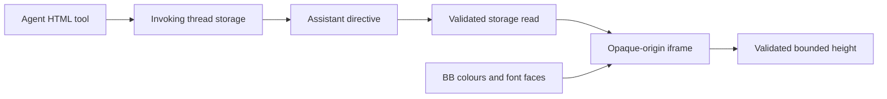

# Visual Replies Prototype

A separate local BB plugin presents compact interactive HTML inside assistant replies.
It uses transparent, borderless, auto-sized iframes without a filename banner or dashboard card.
Plugin id: `visual-replies-prototype`.

## Usage

1. Call `visual_reply_html` with `{html, title}` in an agent session that started after installation.
2. Include the returned directive on its own line in the assistant reply.

```text
::visual-reply{id="9046d75e-a3cb-4538-b664-ddae42379bb7"}
```

Example tool output:

```json
{"id":"9046d75e-a3cb-4538-b664-ddae42379bb7","path":"<thread-storage>/visual-replies/9046d75e-a3cb-4538-b664-ddae42379bb7.html","directive":"::visual-reply{id=\"9046d75e-a3cb-4538-b664-ddae42379bb7\"}"}
```

Run `bb visual-replies-prototype queue` inside a BB thread to create the queue explorer.
Read the [agent style contract](skills/visual-replies/SKILL.md) before authoring other visuals.

## Approach

| Approach | SDK support | Cost |
| --- | --- | --- |
| Message directive with iframe | Public `messageDirective` slot | One tool, storage RPC and a small renderer |
| Native tool-result UI | Timeline tool renderers require a provider registered by this plugin | Requires replacing or owning a provider |

The prototype uses the message directive. It accepts HTML directly through an agent tool.
BB still requires a short directive in assistant text. The tool result itself does not render the visual.
The file format is not the product limitation. The reply renderer supplies placement, theme and content sizing.



## Source

| File | Responsibility |
| --- | --- |
| [server.ts](server.ts) | Native HTML tool, thread storage, RPC and queue command |
| [contracts.ts](contracts.ts) | HTML size limits and UUID validation |
| [app.tsx](app.tsx) | Directive, theme observation, height messages and disposal |
| [frame.ts](frame.ts) | First-paint theme, copied font faces, CSP and child bridge |
| [core.ts](core.ts) | Queue clearance and bounded iframe message validation |
| [queue.ts](queue.ts) | Responsive queue explorer with compact inputs and one chart |

The renderer checks both `event.source` and a per-frame nonce.
The parent removes listeners and observers on unmount. The child releases its bridge on page exit.
BB supplies colours and fonts before frame construction. Live theme updates preserve input state.
Height follows the body's content across viewport changes. It is bounded between 1 and 1,200 pixels.

## Build and local lifecycle

Use the existing runtimes. From this directory:

```sh
mise exec -- pnpm test
mise exec -- pnpm typecheck
mise exec -- pnpm build
bb plugin install path:~/src/bb-plugins/visual-replies-prototype --yes
bb plugin reload visual-replies-prototype
bb plugin disable visual-replies-prototype
bb plugin enable visual-replies-prototype
```

Disable unloads the separate plugin. It does not change bundled inline-vis or custom instructions.

## Verification and limits

Focused tests cover queue maths, storage host ownership, boundary validation, storage conflicts, sandbox setup and listener disposal.
Live browser checks cover keyboard controls, mobile and desktop layout, theme propagation, fonts, reload and content height.
The reference queue keeps chart labels at 12 screen pixels and uses a fixed 220-pixel chart height.

The workspace and live BB both supply SDK 0.6.37. Build and live registration succeed.
The tool uses the SDK's JSON-schema registration overload and parses input explicitly with the workspace Zod version.

Agent-authored charts must follow the style contract. The renderer cannot repair fixed-width SVG layouts automatically.
HTML code can consume CPU inside the sandbox. CSP and iframe isolation do not impose an execution budget.
Fonts from readable same-origin BB stylesheets are copied. External or inaccessible font stylesheets are not copied.
Remote dependencies are blocked. Input state survives theme changes but does not persist across reloads.
Missing storage files produce an inline error. Disabled plugins leave directive handling to BB's fallback.
