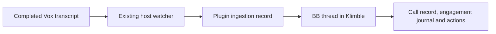

# Vox Recorder

Record calls and monologues with the `vox` CLI from BB, and give live or
finished transcripts to an agent. The plugin wraps `vox`; it does not replace
it. Recording, transcription and the store at `~/Recordings/vox` stay with
`vox`, so a capture started in a terminal shows here too.

BB's own composer dictation covers talking into the prompt. This plugin covers
meeting capture with system audio, the recording library and live-call
transcripts for agents.

Q closes the recordings library outside text fields. Q dismisses a pending confirmation first. Esc also dismisses these layers.

## Use

| Action | Shortcut |
| --- | --- |
| Start or stop recording | `Alt+V` |
| Open the recordings library | `Alt+Shift+V`, or click the header pill |
| Attach the live call so far to the composer | `Alt+Y` |
| Attach the last 5 minutes of the live call | Palette: **Vox: Attach the last 5 minutes of the live call** |

Rebind any of them in Settings → Keyboard. No built-in, override or other
workspace plugin uses these defaults; a colliding plugin default never binds.
`Alt+V` and `Alt+Shift+V` work anywhere outside a modal, a focused terminal
included. `Alt+Y` is a composer command, so it needs a prompt and does not fire
from a terminal. No shortcut fires while a vox dialog is open.

- **Start.** `Alt+V` starts the capture at once and opens a title prompt over
  it. Enter keeps the recording, renamed if you typed a title. Esc discards it
  with `vox cancel`. A prompt that closes with no answer keeps the recording.
- **Stop.** `Alt+V` while recording runs `vox stop` in the background. A notice
  reports the transcript when transcription ends. The capture still reads as
  recording while it flushes, so a second stop or a discard of it is refused.
- **Grab.** `Alt+Y` transcribes the call so far with `vox grab` and inserts an
  `@vox` pill such as "Call so far · 812 words". On send, the pill becomes the
  frozen transcript as agent-only context.
- **Mention.** Type `@` in any composer to search finished transcripts.
- **Agent tool.** `vox_transcript` takes `source`: `live` (with an optional
  `window` such as `5m`), `latest`, `list` (with `query`) or `recording` (with
  `name` from `list`). An agent can answer "what did they just say about
  pricing?" with no keypress.

### Automatic ingestion into Klimble

The plugin watches completed transcripts from both BB and terminal recordings.
Vox publishes a transcript with an atomic rename, so partial merge output cannot
start ingestion. Empty transcripts and live grabs are ignored.



Ingestion is off until its destination is configured:

```sh
bb plugin config vox-recorder set ingestProject <klimble-project-id>
bb plugin config vox-recorder set ingestEnabled true
bb vox ingest status
```

The destination needs a checkout on the recording host. Threads use that checkout
and the Codex provider. The agent reads its business instructions, saves a dated
call record, updates the engagement journal and actions, and commits locally.
Business notes go into Klimble. The personal KB is excluded.

First enablement marks the existing transcript library as skipped. This prevents
historical calls, including manually filed calls, from being ingested again.
To process one existing recording deliberately:

```sh
bb vox ingest run <recording-name>
```

The ingestion record survives reloads. A rename keeps the same recording
identity. Retranscription reuses its existing thread and updates its notes.
Only the latest published revision can be recovered after BB was offline.
The existing 15-second host rescan repairs missed watch notifications.

A created thread is recorded as `spawned`. It becomes `succeeded` only after the
agent calls `vox_ingestion_complete` and the plugin reads the saved Klimble note
with matching transcript provenance. An idle or errored thread without that
confirmation becomes `failed`. Retry uses its existing thread:

```sh
bb vox ingest retry <revision-key>
```

A lost dispatch response becomes `uncertain`. The plugin adopts a thread with
matching metadata after recovery. Without that evidence, it holds the revision
for inspection and creates no replacement automatically.

### Header pill

The pill is hidden while idle, like the tmux status segment.

| Pill | State |
| --- | --- |
| `~ 12m` | Recording for 12 minutes |
| `≈ 40s` or `≈ 2` | Transcribing one recording, or two at once |
| `! 1` | One recording transcribed to nothing |
| `✓ 2` | Two new transcripts |

Opening the library marks everything seen, which clears `!` and `✓`.

### Library

Focus starts in the filter. `↓` moves to the list and keeps the selected row.
In the list:

| Key | Action |
| --- | --- |
| `↵` | Insert the transcript as an `@vox` pill |
| `c` | Copy the transcript |
| `e` | Open it in BB's file preview, beside the thread on screen |
| `r` | Rename |
| `o` | Reveal in Finder |
| `t` | Retranscribe |
| `d` | Delete, after `y` |
| `x` | Delete the audio and keep the transcript, after `y` |
| `/` | Back to the filter |

While recording, the library also offers Grab so far, Last 5 min, Name…,
Stop and Discard. Retranscribe, delete and reclaim refuse the live recording
and one mid-transcription. Reclaim also refuses a recording with no transcript
or an empty one, because its audio is all there is. A question such as
"Delete …?" keeps the row it named, even if the selection moves before `y`.
Name… on a live recording never discards it.

## Design

```mermaid
flowchart LR
  subgraph App[app.tsx, every window]
    Pill[Header pill] --> Lib[Library dialog]
    Keys[Alt+V, Alt+Shift+V, Alt+Y] --> Prompt[Title prompt]
    Lib --> Composer[(Composer @vox pill)]
    Keys --> Composer
  end
  subgraph Server[server.ts]
    RPC[RPC proxy] --> Client[Host client]
    Mention[@vox mention provider] --> Client
    Tool[vox_transcript tool] --> Client
  end
  subgraph Host[host.ts on the primary macOS host]
    Handlers --> Disk[src/disk.ts: statefile, store, seen marker]
    Handlers --> Run[src/run.ts: vox CLI, own process group]
    Watch[Store watch and 15 s rescan] --> Signals[status and finished signals]
  end
  Client --> Handlers
  Signals -- realtime --> Pill
  Composer -- send --> Mention
```

- **State** (`src/state.ts`) is a pure port of `vox_state` over file facts:
  RECORDING, then TRANSCRIBING, EMPTY, READY and IDLE, worst first. Every fact
  is a pid liveness check or an mtime comparison, so no reaper is needed.
- **Watching.** The host watches only the store. The statefile and seen marker
  live in `~/.cache`, a busy shared tree. Every start, stop and transcription
  also writes into the store. A 15 s rescan catches pid deaths and outside
  touches of the seen marker. The host sends a status only when it differs
  from the last one it sent. A window that re-reads the status on focus gets
  its own answer, and the next change still reaches every window. The app
  ticks the elapsed time itself.
- **Process lifetime.** Every `vox` child runs in its own process group, so a
  capture or a long transcription survives a worker restart. Stop and
  retranscribe take one worker lease while the call is open, run their jobs
  one at a time, and release the lease after the last job. Each job always
  sends a `finished` signal, even one that failed to spawn. If the worker
  crashes, the notice is lost, but the pill still moves to `✓` or `!`.
- **Grabs.** The host copies each `grab.md` into its `dataDir/grabs/` before
  the pill is inserted. The mention provider has no documented size limit or
  resolve timeout, and an hour-long call is 60 to 120 KB. So nothing is
  transcribed at send time.
- **Dialogs** set `aria-modal="true"`. BB derives its `modalOpen` context from
  that attribute, not from `showModal()`. Without it, Esc in the title prompt
  would discard the capture and also fire BB's `app.back`.
- **Keys** in the library come from `src/keys.ts`. A focused button keeps Enter
  and Space, so Enter on Stop stops rather than inserting a pill.

## Microphone permission (open)

No capture has run under BB yet. Only starting depends on this: grab, the
library, `@vox` and the agent tool work on a capture started from a terminal.

The process chain is launchd → BB.app (`dev.bb.desktop`) → host daemon → host
worker → `vox` → `voxtap`. macOS attributes the request to the responsible
app, so the grants should belong to BB rather than the terminal that holds
them for tmux. BB.app has the `audio-input` entitlement and both the
`NSMicrophoneUsageDescription` and `NSAudioCaptureUsageDescription` strings.
`voxtap` needs two grants: Microphone, and System Audio Recording for the
process tap. A first detached start waits behind the prompt, and `vox` gives
up after 10 s with "the capture did not start".

### Manual test

1. Open System Settings → Privacy & Security. Note whether BB appears under
   **Microphone** and under **Screen & System Audio Recording**.
2. In BB, open a thread terminal with `Cmd+Shift+Enter`. BB terminals and the
   plugin's host worker are both children of BB's host daemon, so they share
   BB as the responsible app.
3. Run `voxtap --probe 3 --mic Microphone`. It runs the capture for 3 seconds
   and writes no files.
4. Allow any prompt that names BB, then run the probe again. A pass is a
   report of frames, elapsed time and levels on stderr, and exit status 0.
   `AudioHardwareCreateProcessTap failed` means system audio is refused. A
   microphone error means the microphone is refused.
5. Install the plugin and press `Alt+V`. A pass is the `~ 0s` pill with the
   title prompt open. Press Esc to discard. Expect the notice "Discarded
   <name>" and no new directory from `ls -t ~/Recordings/vox | head -1`.
6. If step 3 fails with no prompt, turn BB on under both settings from step 1,
   or run `tccutil reset Microphone dev.bb.desktop`, and repeat from step 3.

If BB cannot hold the grants, keep starting captures from a terminal
(`prefix + Alt+v` in tmux, or `vox`). A launchd-owned `vox` helper is the
other option.

## Known limits

- The pill uses `experimental_threadHeaderAction`, which mounts once per
  visible pane, so a split shows it in each pane. BB has no app-global slot.
- BB has no plugin toast or notification API, so the plugin draws its own
  notice stack. It is a manual popover, so it shows above an open dialog. A
  modal dialog makes the stack inert, so a click on a notice's dismiss button
  closes the library instead. Nothing replaces the tmux bell.
- BB refuses a file preview from the app overlay that holds the library. So
  `e` borrows the opener of a header pill's pane. It needs a thread on screen,
  and with a split it opens in the newest pane.
- Copy uses `experimental_copyToClipboard`, which the 0.6.15 types lack, read
  from the runtime module. A runtime without it falls back to the Clipboard
  API, which needs window focus.
- `registerTool` takes a JSON schema from `z.toJSONSchema` and parses inside
  `execute`. The SDK 0.6.15 types use zod 4.6, and the plugin's zod 4.3 schema
  fails its zod overload.
- vox runs on `system.config().primaryHostId`, which must be macOS.
- The host reads `VOX_STORE`, `VOX_STATEFILE`, `VOX_SEENFILE` and `VOX_BIN`
  from the worker's environment at load. Variables set only in the shell
  config reach `vox` but not those reads. None are set today.
- Grabs in `dataDir/grabs/` are never pruned. A draft can hold a grab pill for
  days, so a safe age needs a decision.
- `@` search reads every recording's `sys.json`, up to 1.6 MB each, on each
  keystroke. A cold worker can miss the 2 s search budget and show no rows.
- The tmux picker's multi-select, play and paste-path are not ported.
- Seen in a running BB (0.46.0): the pill and its realtime updates across two
  windows, the library in light and dark, `Alt+Shift+V`, `Alt+Y` refusing
  when idle, the palette entries with their shortcuts, a `@vox` pill
  inserted from the library, `e` opening the transcript, and `@` search
  returning vox rows from the server. Not yet seen: `Alt+V`, the title prompt,
  the live section, a grab, a mention resolving on send and the agent tool,
  because each needs a live capture or a sent message.

## Development

From this directory:

```sh
pnpm test
pnpm typecheck
pnpm build
bb plugin reload vox-recorder
```

Use `pnpm dev` to rebuild and reload on save. Install with
`bb plugin install path:~/src/bb-plugins/vox-recorder`.

The tests cover the pure ports against the tmux behaviour: statefile parsing,
state precedence, strict seen-marker semantics, the age formatter, the
empty-versus-solo kind, the grab word count, the exit-code contract, the
title-prompt decision, the library keys and the delete and reclaim guards.
`src/host.test.ts` drives the real host entry through the SDK host harness with
real files and a stand-in `vox`. It covers start, grab, rename of the live
capture, detached stop with its `finished` signal and released lease, a refused
second stop and discard while the capture flushes, two retranscriptions in a
row, refused path traversal, and a status change that still reaches every
window after one window re-reads it. No test runs the real `vox` or touches
`~/Recordings/vox`.
