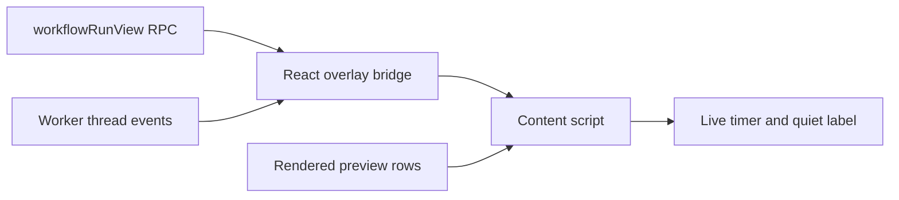

# Workflow Timers

Show how long each running workflow agent has been working, and how long since
it last did anything. The stock inline workflow preview shows durations only for
finished agents, so a stalled agent looks the same as a slow one.

Each running row gets a live elapsed timer in the slot where the finished
duration appears. When the worker thread records no event for two minutes, an
amber `quiet Nm` label appears before the timer. It turns red at ten minutes.
Open **Timing details** below a running row for its exact start and latest event times.
The disclosure supports touch and keyboard. Hovering the timer shows the same times.
A long silent command, such as a test suite, also reads as quiet.

The bridge reads each run's calls through the Workflows plugin's
`workflowRunView` RPC. That view has no live activity time. The call's stored
activity time changes only when the call starts, retries or finishes. The bridge
therefore reads the latest event on the worker's child thread instead. Both
refresh every five seconds; the timer ticks every second.

Rows carry no call IDs. The content script joins a row to its call by label and
omits rows whose label repeats in the run. It decorates only the inline chat
preview, `section[aria-label="Workflow"][title]`, and copies the native
duration span's classes. These are BB internals. Markup changes can break
decoration after a BB update. A native duration replaces the timer once the
preview reports the call finished.

Disabling the plugin removes its timers, observers, intervals and pending
requests. It modifies no BB application files or workflow data.

Build, test, install and reload through the [workspace guide](../README.md).
The shared [DOM decoration guide](../docs/dom-decorations.md) describes the method.
