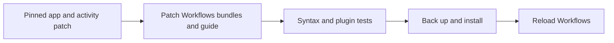

# Workflows Daybreak bundle patch

BB 0.46.1 Workflows accepts `sessionOptions` on `agent()`, validates each value
against the selected model, passes the options to the direct worker, includes
them in the cache key, and shows provider labels in both progress views.

This is an exact-hash patch of the installed Workflows `server.js`, `app.js`
and workflow authoring guide.
It does not build BB or change the Workflows plugin ID. It requires the existing
workflow activity patch in the BB core and preserves its source registration.



## Apply

Run from `~/src/bb-plugins/workflows-patch`. Finish active workflows first.
The script refuses any unrecognised core or Workflows file hash. It backs up
the original files under `~/.local/share/bb-bundle-patches/workflows-daybreak-0.46.1`.

```sh
python3 scripts/patch-bundle.py check
python3 scripts/patch-bundle.py prepare --output /private/tmp/bb-daybreak-review
node --check /private/tmp/bb-daybreak-review/builtin-plugins/workflows/dist/server.js
node --check /private/tmp/bb-daybreak-review/builtin-plugins/workflows/dist/app.js
python3 scripts/patch-bundle.py apply
bb plugin reload workflows
python3 scripts/patch-bundle.py check
```

Reloading the plugin updates server execution. Reload the desktop window to
load the changed `app.js` progress view. A full BB restart is the fallback if
plugin reload fails.

## Restore

```sh
python3 scripts/patch-bundle.py restore
bb plugin reload workflows
```

The restore command accepts only pinned file hashes and verified backups. It
restores the prior Workflows bundles and guide, including their activity hook.
BB core remains untouched.

An app update will replace the patch. Treat a hash mismatch as a new version
that needs a fresh, reviewed patch. Do not force the script or copy old bundles
over an update.
