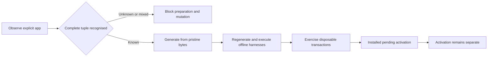

# BB bundle patch registry

The registry prepares exact BB 0.47.1 desktop bundles without compiling BB or a bundled plugin.
The manager inspects explicit installations and verifies copied candidates.
Its apply and restore commands admit only disposable copies beneath the operating system's canonical user temporary directory.
They never reload plugins, restart servers or invoke an updater.

| Set | Changes | Activation requirement |
| --- | --- | --- |
| `session-options` | Workflows server, progress view and authoring guide | Server and desktop view activation |
| `activity` | Core aggregation and Workflows server | Full server activation |
| `session-options-plus-activity` | Session options, then activity | Full server and desktop view activation |

Session options remain independent of activity. The combined manifest pins both intermediate and final tuples.
Every manifest guards core, Workflows server, progress view and authoring guide, including unchanged files.
The release adapter contains the reviewed transformations. Historical private archives never supply executable recipes.



## Inspect and prepare

The dual-mode [bb-patch wrapper](../../../.config/zsh/functions/patch/bb-patch) calls
[the Python manager](scripts/bb_patch.py). Run `zfn-link` after installing the wrapper.
Every new installation command requires an absolute `--app` path.
Identity comes from that app's plist, Mach-O executable and complete bundle tuple.
`BB_CLI`, the calling process and mise's separate `bb-app` package do not identify the desktop.

```sh
bb-patch inspect --app /Applications/bb.app --require-set session-options-plus-activity --json
bb-patch prepare --app /Applications/bb.app --set session-options-plus-activity --output /private/tmp/bb-candidate-review
bb-patch verify --plan /private/tmp/bb-candidate-review/plan.json
```

Preparation requires a fresh output directory outside the installation, with no ancestor overlap or symlink targets.
It writes all four candidate files, a pristine input tree and `plan.json`. It leaves installation bytes and metadata unchanged.
Preparing from a recognised patched installation requires verified pristine objects in the manager's private object store.
The manager never reverses text replacements.
Unknown releases or bytes block executable preparation, even when text anchors match.

Candidate identity hashes canonical JSON containing the complete recipe, input digests and candidate tuple.
Installation paths and filesystem identity sit in a separate binding.
Repeated preparation produces identical candidate bytes and identity.
Verification checks the current tracked manifest, adapter and harness digests, regenerates every intermediate tuple, then executes the harnesses.
A saved success flag cannot substitute for execution.
`verification.json` binds completed offline checks to candidate, manifest, adapter and harness digests.
Verification rechecks bytes and inputs after harness execution. Activation and runtime status remain unknown.

Inspection returns these statuses:

| Exit | Meaning |
| --- | --- |
| `0` | Recognised complete tuple. Any required capabilities are present. |
| `1` | Recognised complete tuple. Required capabilities are missing. |
| `2` | Unknown, mixed, missing, unsafe or invalid installation or registry. |

The combined set satisfies either constituent requirement. Requiring the combined set requires both patches.
JSON reports observation, complete-tuple classification, observed and required sets, missing patches and pending transactions.
Activation and runtime verification remain `unknown`. Offline verification cannot establish either.
Known per-file mixtures remain unhealthy. Legacy session-options mixtures and journal-backed mixtures remain distinct.

## Offline checks

```sh
python3 -B -m unittest discover -s scripts -p 'test_*.py'
```

Independent synthetic registry and transaction fixtures run without `/Applications/bb.app`.
Release tests skip explicitly unless `BB_PATCH_RELEASE_APP` names a verified disposable release copy.
That copy needs the four guarded files, `Contents/Info.plist` and `Contents/MacOS/bb` from the same release.

```sh
BB_PATCH_RELEASE_APP=/absolute/system-temporary-directory/release/bb.app python3 -B -m unittest discover -s scripts -p 'test_*.py'
```

The session harness resolves Zod and SDK imports from the adjacent `workflow-timers` package.
Workspace dependencies must already be installed. Node must provide `node:sqlite` for the activity harness.
The activity harness executes copied core and plugin fragments together against synthetic SQLite records.
It checks lifecycle counting, activation failure, invalidation, stale generations, source failures and progress publication.
Syntax checks establish parsing only.
The scoped `workflows-patch` hook runs independent tests and validates tracked input fingerprints.
Copied-release behaviour remains an explicit check when release fixtures are absent.

To measure the actual copied query and aggregation, set `BB_PATCH_MEASUREMENTS` to an evidence file:

```sh
BB_PATCH_MEASUREMENTS=/private/tmp/bb-query-measurements.json node scripts/test-activity.mjs /private/tmp/bb-candidate-review/start-server.js /private/tmp/bb-candidate-review/builtin-plugins/workflows/dist/server.js
```

The fixture has 100,000 rows, terminal history, many active origins and concentrated history.
Each active row contains 128 KiB of source text. The snapshot selects only run and origin IDs.
It measures seven repetitions for 100, 1,000 and 5,000 threads.
The initial review budget is 100 ms p95 at 5,000 threads.
The adapter uses one read-only active-run snapshot per aggregation, grouped by origin.
It keeps no persistent activity cache or database index.
Each source retains its last valid per-origin count only within its owning API generation.
A failed shared refresh emits one warning per aggregation. Per-origin validation errors retain their own diagnostics.
Without a previous valid snapshot, source failure raises `activity-source-unavailable` instead of returning zero.

## Disposable transactions and recovery

Only `approved-offline` manifests authorise copied-installation transactions. Draft recipes can prepare and verify candidates.
Offline approval grants no live installation authority.
Create disposable roots with Python's `tempfile` and resolve their paths before using them.
On macOS, admission uses `getconf DARWIN_USER_TEMP_DIR`, independent of `TMPDIR`.
The plan binds the exact root device, inode, release generation, metadata and complete input tuple.

```sh
bb-patch apply --app /absolute/system-temporary-directory/release/bb.app --plan /private/tmp/bb-candidate-review/plan.json
bb-patch restore --app /absolute/system-temporary-directory/release/bb.app --transaction <transaction-id>
```

Private state lives under `~/.local/share/bb-bundle-patches/manager/`:
`objects/` holds verified content-addressed pristine and pre-transaction bytes;
`transactions/` holds durable intent and progress;
`locks/` holds canonical-installation advisory locks.
Do not edit journals or substitute objects from another release.

The manager verifies backups before intent, stages every changed file, journals each replacement and checks actual hashes before replacement.
It preserves uid, gid, mode and supported extended attributes. It rejects ACLs, hard links, privileged modes and unsupported ownership.
Non-zero file flags block transactions before backup objects or journals.
Zero flags retain the existing metadata representation for plan and journal compatibility.
Replacement uses pinned parent-directory descriptors. A concurrent root replacement cannot redirect the rename into the replacement generation.
It verifies the complete final tuple, including unchanged guards.
Successful application records `installed-pending-activation`.

Recovery compares actual files with recorded before and after tuples. A crash after rename remains recoverable before progress recording.
Restore verifies both object tuples and installation identity before writing.
Unexpected bytes, missing objects or a replaced root block recovery and preserve destinations.
A write failure attempts restoration; failed restoration remains journalled for another explicit restore.
Repeated restoration is safe for recognised bytes.
To remove one feature, prepare the remaining complete set from pristine objects. Never restore a single shared server file.

States are `prepared`, `backed-up`, `installing`, `installed-pending-activation`, `restoring`, `restored` and `blocked-unexpected-bytes`.
A manager lock does not exclude Homebrew or the native updater.
Per-file rename is not application-wide atomicity. Process termination tests do not prove power-loss durability.
Restoring files does not reverse runtime record effects.
No command signs the app, removes quarantine or changes integrity controls.
Live installation remains blocked pending independent maintenance admission, updater exclusion and modified-app integrity evidence.

## Legacy session-options entrypoint

[patch-bundle.py](scripts/patch-bundle.py) preserves `check`, `prepare`, `apply` and `restore`, their flags, messages and output layout.
Its default app is `/Applications/bb.app`.
Its default output and backup root is `~/.local/share/bb-bundle-patches/workflows-daybreak-0.47.1`.
Prepared files sit directly under that root; verified stock backups sit under `backup/`.
The legacy entrypoint retains its existing mutation authority. The manager does not invoke it.

Legacy `check` accepts each of the three Workflows targets independently and requires stock core.
Its success can describe a mixed installation. Use manager inspection to assess a complete set or required capability.
Legacy apply and restore retain verified backup recovery for mixed session-options targets.
Unknown bytes or corrupt backups refuse writes. Legacy restoration does not reinterpret activity or combined sets.

Session options accept boolean and select values, validate fixed settings and reach direct worker spawning.
Absent options preserve stock cache identity. Explicit empty options preserve historical patched identity.
Stored labels support progress without a live provider catalogue.
Patched readers accept stock and historical option records, and preserve origin ownership checks.
Stock readers cannot preview every historical patched record after file restoration.
Installer database writes and runtime record compatibility are separate claims.

## Updates, porting and retirement

`up` performs advisory inspection after standalone Homebrew and applicable macOS activation paths, including failures and frozen activation.
Inspection never prepares, installs or activates patches. Its result preserves required-phase exit status.
Native desktop updates can occur outside `up`. Run the explicit inspect command after each native update.
A missing desktop is reported directly. The CLI installation is never substituted.

1. Inspect the explicit new installation and record its release identity and complete pristine tuple.
2. Run equivalent acceptance tests against pristine upstream. Retire any patch whose behaviour upstream supplies.
3. Add a separate release adapter and draft manifests for remaining patches. Resolve identifiers through actual lifecycle functions.
4. Add the release and adapter path to `RELEASE_ADAPTERS` in `scripts/bb_patch.py` before candidate preparation.
   Retain admitted releases. Registry uniqueness and pristine consistency apply within each installation identity.
5. Prepare fresh scratch candidates. Run independent session-options, activity, combined, recovery and performance checks.
6. Review adapter, harness, intermediate and final fingerprints. Perform adversarial and simplification passes before offline approval.
7. Keep live application blocked until maintenance admission, updater exclusion and integrity controls are independently established.

The authoring source maps remain unchanged. They do not accurately map inserted code.
Never copy archived generated bundles into a new release or discover recipes from private backup archives.

Draft final tuples do not satisfy patch requirements. Draft recipes still permit preparation and offline verification from recognised pristine inputs.
