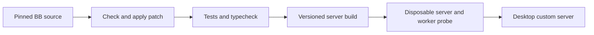

# Workflows session options patch

This patch builds BB 0.46.1 with native provider session options for workflow
workers. `agent()` accepts `sessionOptions`, checks each choice against the
selected model, passes the choices to the direct worker, includes them in cache
identity, and displays their provider labels beside the model.

The source pin and patch live here. A change to the upstream tag or matching
source makes preparation fail. The running BB installation is separate.

## Prepare and build

`scripts/prepare.sh <new-source-dir>` clones the pinned tag and checks its exact
commit before applying patches. Run Workflows tests, typecheck and formatting in
that directory. `scripts/build.sh <new-source-dir> <new-install-dir>` performs a
fresh preparation and builds a standalone `bb-app` server. Both paths must be new.
The install records the source revision and patch hashes.

Builds use BB's pnpm lockfile. Install scripts remain blocked; `pnpm run prepare`
invokes the required source generation explicitly. A failed patch or build leaves
the previous installation available.

## Activate

Use a fresh BB data directory and spare ports to check `/health`, the UI and a
direct Daybreak worker before changing the desktop server. After active workflow
runs finish, stop the desktop's bundled server and point the desktop at the
versioned candidate server. Keep the prior server path and desktop setting for
rollback. The desktop and patched server must use the same BB version.

The patch is temporary. Remove it when stock Workflows accepts and displays
session options.
