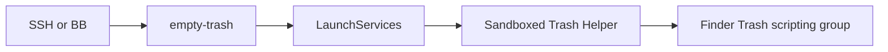

# Trash Helper

Empty Finder's Trash from SSH or BB without Full Disk Access on either caller.
The helper runs as the desktop user. It sends one fixed Finder Apple Event.
It accepts no file paths, scripts or configuration.

## Build and install

Requires macOS, Xcode command-line tools and Python 3 for tests.

1. Run `make build test` from this directory. Tests never empty Trash.
2. Run `sudo make install` from this directory. This installs a root-owned app and command under `/usr/local`.
3. From the Mini's desktop session, run `/usr/local/bin/empty-trash authorise`. Approve Trash Helper's Finder request.
4. From SSH or BB, run `/usr/local/bin/empty-trash check`. This checks permission without deleting files.
5. To empty Finder's Trash, run `/usr/local/bin/empty-trash empty`. This permanently deletes its current contents, including mounted-volume Trash.

Installation resumes when an existing app matches the build byte for byte. It refuses a different or invalid app. Do not run the helper with sudo.
Finder needs a logged-in desktop session. FileVault needs unlock after a restart.

## Permission boundary

The signed app enables App Sandbox and Hardened Runtime. Its scripting-targets entitlement names only `com.apple.finder.trash`.
Finder declares that access group on its `empty` command.
No Full Disk Access, Accessibility, network entitlement or general Finder Apple Event exception is requested.

The app and its parent directory belong to root. The caller cannot replace its executable without administrator approval.
LaunchServices starts the app separately from the SSH or BB process to establish its own permission identity.
The CLI stores the result in a private temporary directory and returns the helper's status.
A timeout means the outcome is unknown. Inspect Finder before retrying.

The build uses ad-hoc signing. Rebuilds can change its signing identity and require renewed approval.
The sandbox's scripting restriction needs live verification after consent. A permission check alone does not prove deletion works.

An authorised caller can empty all Trash. It can also move files it already controls into Trash before requesting emptying.
This capability does not contain a compromised root daemon or protect files the caller can already delete.

## Verification

`make test` checks argument rejection, the code signature, Hardened Runtime and the exact entitlement set.
Tests launch the signed apps through LaunchServices, matching the CLI.
A separate probe verifies that the sandbox denies reading a repository file and connecting to a loopback socket.
It does not grant permission, send deletion events or test a logged-out desktop session.

Before enabling unattended use, verify permission attribution through LaunchServices from SSH and BB.
Verify that another Finder operation is denied in a separate sandbox probe.
Test deletion with disposable files only after reviewing existing Trash in Finder.

Apple documents [scripting access groups](https://developer.apple.com/library/archive/documentation/Miscellaneous/Reference/EntitlementKeyReference/Chapters/EnablingAppSandbox.html).
The installed Finder dictionary is `/System/Library/CoreServices/Finder.app/Contents/Resources/Finder.sdef`.
